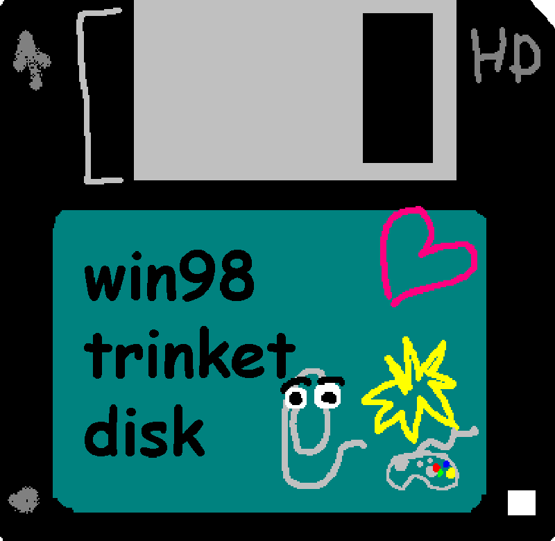

# win98 trinket disk
Newly developed utilities and drivers for old systems.

## Drivers

### NUSB 3.6 Universal – USB mass storage

USB flash drives, card readers and cameras plus a generic USB 2.0 stack for
Windows 98 SE in any language. A rebuild of Maximus Decim's NUSB 3.6 that keeps
your Windows in its own language instead of overwriting system files with
English ones – and is simpler and safer to install: no manual Device Manager
clean-up, file checks, backup and full uninstall.

* Download: [NUSB36UNIV.EXE](https://github.com/xx0x/win98-trinket-disk/raw/main/drivers/usb-mass-storage/NUSB36UNIV.EXE)
* More info: [drivers/usb-mass-storage](drivers/usb-mass-storage/README.md)

### XPAD98 – Xbox controllers

A driver that lets Xbox 360, Xbox One and Xbox Series X|S controllers and
compatible third-party controllers work on Windows 98 SE over a USB connection.
An adaptation of the Linux `xpad` driver. Works with or without NUSB.

* Download: [XPAD98.INF](https://github.com/xx0x/win98-trinket-disk/raw/main/drivers/xbox-gamepad/XPAD98.INF) and [XPAD98.SYS](https://github.com/xx0x/win98-trinket-disk/raw/main/drivers/xbox-gamepad/XPAD98.SYS) (keep both in one folder)
* More info: [drivers/xbox-gamepad](drivers/xbox-gamepad/README.md)

## AI and Transparency

The contents of this repository were developed primarily using AI models
(specifically Claude Opus 5.5). Even though the author tried to verify most of
the things, there is absolutely no responsibility of any kind – use everything
here at your own risk.
